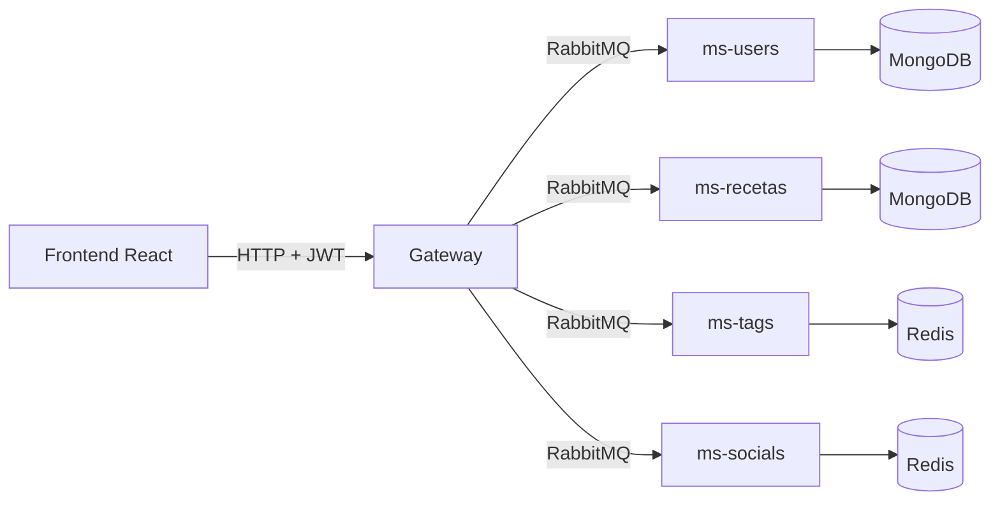

# Remi Recetas · Gateway

[](https://github.com/florenciaPenaSepulveda/remi-gateway/actions/workflows/ci.yml)

**Remi Recetas** es una plataforma para compartir recetas: se registran las recetas con sus ingredientes (las calorías se calculan solas), se buscan por ingredientes, categorías o calorías, y se puede reaccionar y comentar. Está hecha como microservicios; este repositorio es el **gateway**, la única puerta de entrada HTTP: autentica a las personas, valida lo que llega y reparte cada petición al microservicio que corresponde por RabbitMQ. Hecho con NestJS 11.

## Repositorios del sistema

| Repositorio | Función | Base de datos |
|---|---|---|
| **remi-gateway** (este) | API HTTP pública, autenticación y enrutamiento | — |
| [remi-ms-users](https://github.com/florenciaPenaSepulveda/remi-ms-users) | Usuarios, inicio de sesión y tokens | MongoDB |
| [remi-ms-recetas](https://github.com/florenciaPenaSepulveda/remi-ms-recetas) | Recetas e ingredientes | MongoDB |
| [remi-ms-tags](https://github.com/florenciaPenaSepulveda/remi-ms-tags) | Etiquetas de las recetas | Redis |
| [remi-ms-socials](https://github.com/florenciaPenaSepulveda/remi-ms-socials) | Me gusta y comentarios | Redis |
| [remi-frontend](https://github.com/florenciaPenaSepulveda/remi-frontend) | Aplicación web en React | — |



El gateway no guarda datos ni conoce el secreto de los tokens: para saber quién hace una petición le pregunta al servicio de usuarios (`validate_token`), que también comprueba que la cuenta siga existiendo. Cada servicio escucha su propia cola y responde con datos o con un error `{ status, message }` que el gateway convierte en HTTP.

## Rutas

Las rutas marcadas con 🔒 exigen `Authorization: Bearer <accessToken>`; las marcadas con 👤 aceptan visitantes y se personalizan si hay sesión.

| Método y ruta | Descripción |
|---|---|
| `GET /health` | Estado del gateway |
| `POST /users` | Crear cuenta (`name`, `email`, `password`) |
| `POST /users/login` | Iniciar sesión: devuelve `accessToken`, `refreshToken` y `user` |
| `POST /auth/refresh-token` | Renovar la sesión con el refresh token |
| `GET /users/me` 🔒 | Perfil propio |
| `GET /users/:id` 🔒 | Perfil público de otra persona (solo `id` y `name`) |
| `GET /recipes` | Todas las recetas |
| `GET /recipes/mine` 🔒 | Recetas de quien consulta |
| `GET /recipes/:id` | Una receta con sus ingredientes |
| `POST /recipes` 🔒 | Crear receta; la autoría sale del token |
| `PATCH /recipes/:id` 🔒 | Editar (solo la autora) |
| `DELETE /recipes/:id` 🔒 | Eliminar (solo la autora); limpia sus comentarios, reacciones y etiquetas |
| `GET /recipes/search/by-ingredients?ingredients=a,b&mode=all\|any` | Buscar por ingredientes |
| `GET /recipes/search/calories?max=` | Buscar por calorías máximas |
| `GET /recipes/search/calories-range?min=&max=` | Buscar por rango de calorías |
| `GET /recipes/search/by-categories?categories=a,b` | Buscar por categorías |
| `GET /ingredients`, `GET /ingredients/:id` | Catálogo de ingredientes |
| `POST /ingredients`, `PATCH /ingredients/:id`, `DELETE /ingredients/:id`, `POST /ingredients/populate` 🔒 | Administrar el catálogo |
| `GET /tags`, `GET /tags/search?name=`, `GET /tags/:id` | Consultar etiquetas |
| `GET /tags/by-recipes?ids=a,b` | Etiquetas de varias recetas en una consulta |
| `GET /tags/:id/recipes` | Recetas con una etiqueta |
| `POST /tags` 🔒 | Crear etiqueta |
| `GET /recipes/:id/tags` | Etiquetas de una receta |
| `PUT /recipes/:id/tags` 🔒 | Reemplazar las etiquetas (solo la autora) |
| `GET /recipes/:id/stats` 👤 | Me gusta, no me gusta, comentarios y tu reacción |
| `GET /recipes/stats?ids=a,b` 👤 | Lo mismo para varias recetas |
| `PUT /recipes/:id/reaction` 🔒 | Reaccionar: `{ "type": "like" \| "dislike" }` |
| `DELETE /recipes/:id/reaction` 🔒 | Quitar la reacción |
| `GET /recipes/:id/comments?limit=&offset=` | Comentarios con el nombre de quien comenta |
| `POST /recipes/:id/comments` 🔒 | Comentar |
| `PATCH /comments/:id`, `DELETE /comments/:id` 🔒 | Editar o eliminar un comentario propio |

Los errores siempre tienen la forma `{ statusCode, error, message }`; `message` es una lista cuando hay varios motivos de validación. Los cuerpos se validan en el microservicio dueño del dato, que rechaza los campos que no corresponden; el gateway solo exige que el cuerpo sea un objeto JSON y que los IDs tengan formato válido.

## Seguridad

- Toda ruta que modifica datos exige sesión, y la identidad sale siempre del token: aunque el cuerpo incluya un `userId`, el gateway lo sobrescribe.
- Solo la autora puede editar o eliminar su receta o cambiar sus etiquetas, y solo quien escribió un comentario puede editarlo o borrarlo. Lo comprueban los servicios dueños del dato.
- El inicio de sesión, el registro y la renovación tienen límites propios (10 por minuto los dos primeros) además del límite general por IP (`RATE_LIMIT`).
- `helmet` agrega las cabeceras de seguridad, CORS admite solo los orígenes de `CORS_ORIGINS` y no hay listado público de usuarios.
- Cada llamada a un microservicio tiene un tiempo máximo (`RPC_TIMEOUT_MS`): si un servicio no responde, la petición termina con 504 en lugar de quedar colgada.
- Un servicio de usuarios caído se informa como error del servidor, nunca como "token inválido".
- El gateway no arranca con configuración inválida y no guarda secretos: no versiona ningún `.env`.

Limitación conocida: no hay roles. Cualquier persona con sesión puede administrar el catálogo de ingredientes; un ingrediente en uso por alguna receta no se puede eliminar.

## Requisitos

- Node.js 24 (ver `.nvmrc`).
- Docker, para levantar la infraestructura.

## Puesta en marcha de todo el sistema

1. Infraestructura (RabbitMQ, MongoDB y Redis):

   ```bash
   docker compose up -d
   ```

2. Cada microservicio, en su carpeta, con su `.env` (ver el README de cada uno). Por ejemplo, para el de usuarios:

   ```bash
   cp .env.example .env     # y elige un JWT_SECRET de al menos 32 caracteres
   npm ci
   npm run start:dev
   ```

   Repite lo mismo en `remi-ms-recetas`, `remi-ms-tags` y `remi-ms-socials`.

3. El gateway:

   ```bash
   cp .env.example .env
   npm ci
   npm run start:dev
   ```

4. El frontend, en `remi-frontend` (ver su README). Por defecto espera el gateway en `http://localhost:3000` y el gateway acepta el origen `http://localhost:3001`.

## Datos de ejemplo

Con todo el sistema en marcha, `npm run seed` carga 4 usuarios de prueba, 32 ingredientes con sus calorías, 10 etiquetas, 14 recetas con foto y algunas reacciones y comentarios. Se puede repetir sin duplicar nada. Las cuentas son `camila@remi.cl`, `matias@remi.cl`, `valentina@remi.cl` y `diego@remi.cl`, todas con la clave `Remi12345`; la variable `API_URL` cambia la dirección del gateway (por defecto `http://localhost:3000`).

| Variable | Descripción | Por defecto |
|---|---|---|
| `PORT` | Puerto HTTP | `3000` |
| `AMQP_URI` | Conexión a RabbitMQ | `amqp://localhost:5672` |
| `USERS_QUEUE`, `RECIPES_QUEUE`, `TAGS_QUEUE`, `SOCIALS_QUEUE` | Colas de cada servicio | `users_queue`, `recipes_queue`, `tags_queue`, `socials_queue` |
| `RPC_TIMEOUT_MS` | Tiempo máximo de espera por servicio | `8000` |
| `CORS_ORIGINS` | Orígenes permitidos, separados por coma | `http://localhost:3001` |
| `RATE_LIMIT` | Peticiones por minuto y por IP | `120` |
| `TRUST_PROXY` | `true` si va detrás de un proxy | `false` |

## Pruebas

```bash
npm test
npm run test:cov
npm run lint
```

Las pruebas levantan el gateway completo con los microservicios simulados y recorren las rutas por HTTP: autenticación, permisos, orden de las rutas, validación de entradas, formato de errores, límites de uso, CORS y cabeceras de seguridad. No necesitan RabbitMQ ni bases de datos. Cada microservicio tiene además sus propias pruebas contra su base de datos real. El CI ejecuta lint, compilación y pruebas con cobertura.

## Docker

```bash
docker build -t remi-gateway .
docker run --env-file .env -p 3000:3000 remi-gateway
```

## Autoría

Proyecto desarrollado en equipo durante la carrera. Esta copia forma parte del portafolio de [Florencia Peña Sepúlveda](https://github.com/florenciaPenaSepulveda), que la revisó, corrigió y documentó.
