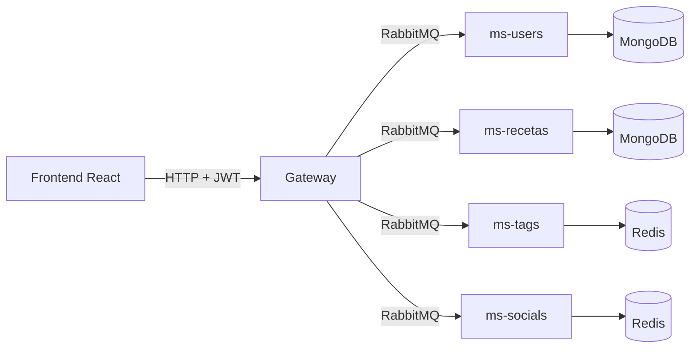

# Remi Recetas · Gateway

[](https://github.com/florenciaPenaSepulveda/remi-gateway/actions/workflows/ci.yml)

**Remi Recetas** es una plataforma para cocinar con lo que ya tienes y no desperdiciar comida: se busca por los ingredientes que sobran, se guardan las recetas en listas propias, se lleva el historial de lo cocinado y se construye una comunidad con puntuaciones y reputación. Está hecha como microservicios; este repositorio es el **gateway**, la única puerta de entrada HTTP: autentica a las personas, valida lo que llega y reparte cada petición al microservicio que corresponde por RabbitMQ. Hecho con NestJS 11.

## Repositorios del sistema

| Repositorio | Función | Base de datos |
|---|---|---|
| **remi-gateway** (este) | API HTTP pública, autenticación y enrutamiento | — |
| [remi-ms-users](https://github.com/florenciaPenaSepulveda/remi-ms-users) | Usuarios, inicio de sesión y tokens | MongoDB |
| [remi-ms-recetas](https://github.com/florenciaPenaSepulveda/remi-ms-recetas) | Recetas e ingredientes | MongoDB |
| [remi-ms-tags](https://github.com/florenciaPenaSepulveda/remi-ms-tags) | Etiquetas de las recetas | Redis |
| [remi-ms-socials](https://github.com/florenciaPenaSepulveda/remi-ms-socials) | Me gusta y comentarios | Redis |
| [remi-frontend](https://github.com/florenciaPenaSepulveda/remi-frontend) | Aplicación web en React | — |



El gateway no guarda datos ni conoce el secreto de los tokens: para saber quién hace una petición le pregunta al servicio de usuarios (`validate_token`), que también comprueba que la cuenta siga existiendo. Cada servicio escucha su propia cola y responde con datos o con un error `{ status, message }` que el gateway convierte en HTTP.

## El producto

**Remi Recetas ayuda a que menos comida termine en la basura.** En un hogar típico se echan a perder verduras, sobras y ingredientes sueltos porque nadie sabe qué cocinar con ellos. La plataforma da vuelta la búsqueda: en lugar de partir de una receta y salir a comprar, la persona parte de **lo que ya tiene** y descubre qué puede cocinar hoy.

### Propuesta de valor

| Para quién | Qué resuelve |
|---|---|
| Quien cocina en casa | "Tengo tomate, huevo y arroz: ¿qué hago?" Recetas que se pueden preparar ya o que solo necesitan uno o dos ingredientes más, sin contar la sal ni el aceite. |
| Quien comparte recetas | Un lugar donde sus recetas se cocinan de verdad, con puntuaciones y una reputación visible. |
| La comunidad | Un recetario común cuyo impacto se mide: comidas cocinadas y kilos de comida aprovechados. |

### Qué incluye hoy

- **Despensa:** se agregan los ingredientes que se tienen y los resultados se agrupan en "puedes cocinarla ahora", "te falta 1" y "te faltan 2 o 3", con el detalle de lo que falta. Los básicos (sal, aceite, azúcar) se asumen y no cuentan. La despensa se recuerda entre visitas y también funciona para invitados.
- **Recetario personal:** listas propias ("Cenas rápidas", "Para la semana"), una lista de favoritas que se crea sola y un historial de **lo que ya cociné**, con fecha y nota, para volver a hacerlo.
- **Cociné esto:** se registra una receta como cocinada, indicando si se usaron ingredientes que ya había en casa. Esa marca alimenta el impacto de la comunidad y la reputación de quien la creó.
- **Puntuaciones y reputación:** las recetas se puntúan de 1 a 5 (no se puede puntuar la propia). Cada creador tiene un perfil público con su promedio, cuántas veces otras personas cocinaron sus recetas y un nivel (aprendiz, cocinero, chef).
- **Impacto:** un contador público de comidas cocinadas y kilos aprovechados, estimado a partir de lo que pesan los ingredientes principales de cada receta cocinada con la despensa.
- **Datos que importan al cocinar:** calorías calculadas, tiempo de preparación y dificultad.

### Por qué unirse

Sin cuenta se puede buscar y leer. Con cuenta se puede guardar en listas, llevar el historial, puntuar, comentar, publicar y construir reputación. La portada se lo recuerda a los invitados.

### Cómo se mediría

| Métrica | Qué dice |
|---|---|
| Comidas cocinadas con la despensa | Si la promesa funciona: la gente cocina lo que la app sugiere. |
| Kilos aprovechados (estimado) | El impacto contra el desperdicio, el relato del producto. |
| Búsquedas por despensa que terminan en una receta cocinada | Qué tan útil es la sugerencia. |
| Personas que vuelven a cocinar o guardan en listas | Retención: el recetario como hábito. |
| Recetas nuevas y puntuación promedio | Salud de la comunidad creadora. |

### Ideas para crecer (no implementadas)

- Planes de menú semanal armados con lo que hay en la despensa y avisos de lo que está por vencer.
- Alianzas con supermercados y ferias: cupones sobre el ingrediente que más falta en las recetas casi listas.
- Cuentas para creadores con estadísticas y recetas destacadas, y perfiles verificados de nutricionistas.
- Lista de compras que sugiere solo lo que completa una receta.
- Despensa sincronizada entre los integrantes de un hogar.

## Rutas

Las rutas marcadas con 🔒 exigen `Authorization: Bearer <accessToken>`; las marcadas con 👤 aceptan visitantes y se personalizan si hay sesión.

| Método y ruta | Descripción |
|---|---|
| `GET /health` | Estado del gateway |
| `POST /users` | Crear cuenta (`name`, `email`, `password`) |
| `POST /users/login` | Iniciar sesión: devuelve `accessToken`, `refreshToken` y `user` |
| `POST /auth/refresh-token` | Renovar la sesión con el refresh token |
| `GET /users/me` 🔒 | Perfil propio con sus estadísticas (recetas cocinadas y gramos aprovechados) |
| `GET /users/:id/profile` | Perfil público de un creador: nivel, promedio, veces cocinadas por otras personas y sus recetas |
| `GET /impact` | Impacto de la comunidad: comidas cocinadas, kilos aprovechados, recetas y personas |
| `GET /recipes` | Todas las recetas, con su autor |
| `GET /recipes/mine` 🔒 | Recetas de quien consulta |
| `GET /recipes/:id` | Una receta con sus ingredientes y su autor |
| `POST /recipes` 🔒 | Crear receta (admite `prepMinutes` y `difficulty`); la autoría sale del token |
| `PATCH /recipes/:id` 🔒 | Editar (solo la autora) |
| `DELETE /recipes/:id` 🔒 | Eliminar (solo la autora); limpia sus comentarios, puntuaciones, etiquetas y corrige la reputación |
| `GET /recipes/search/by-pantry?ingredients=a,b&maxMissing=3` | Qué cocinar con lo que se tiene: cada receta trae `match` con lo que se tiene, lo que falta y el porcentaje |
| `GET /recipes/search/by-ingredients?ingredients=a,b&mode=all\|any` | Buscar por ingredientes (exacto) |
| `GET /recipes/search/calories?max=` | Buscar por calorías máximas |
| `GET /recipes/search/calories-range?min=&max=` | Buscar por rango de calorías |
| `GET /recipes/search/by-categories?categories=a,b` | Buscar por categorías |
| `GET /ingredients`, `GET /ingredients/:id` | Catálogo de ingredientes (con la marca `staple` de los básicos) |
| `POST /ingredients`, `PATCH /ingredients/:id`, `DELETE /ingredients/:id`, `POST /ingredients/populate` 🔒 | Administrar el catálogo |
| `GET /tags`, `GET /tags/search?name=`, `GET /tags/:id` | Consultar etiquetas |
| `GET /tags/by-recipes?ids=a,b` | Etiquetas de varias recetas en una consulta |
| `GET /tags/:id/recipes` | Recetas con una etiqueta |
| `POST /tags` 🔒 | Crear etiqueta |
| `GET /recipes/:id/tags` | Etiquetas de una receta |
| `PUT /recipes/:id/tags` 🔒 | Reemplazar las etiquetas (solo la autora) |
| `GET /recipes/:id/stats` 👤 | Promedio, cantidad de puntuaciones, tu puntuación, veces cocinada, guardada y comentarios |
| `GET /recipes/stats?ids=a,b` 👤 | Lo mismo para varias recetas |
| `PUT /recipes/:id/rating` 🔒 | Puntuar de 1 a 5 (no la propia receta); repetir la llamada cambia la puntuación |
| `DELETE /recipes/:id/rating` 🔒 | Quitar la puntuación |
| `POST /recipes/:id/cooked` 🔒 | Registrar que se cocinó (`usedPantry`, `note`); una vez por receta y por día |
| `GET /recipes/:id/comments?limit=&offset=` | Comentarios con el nombre de quien comenta |
| `POST /recipes/:id/comments` 🔒 | Comentar |
| `PATCH /comments/:id`, `DELETE /comments/:id` 🔒 | Editar o eliminar un comentario propio |
| `GET /cookbook/lists` 🔒 | Mis listas (la de favoritas se crea sola) con las recetas que contiene cada una |
| `POST /cookbook/lists` 🔒 | Crear una lista (hasta 20, nombre único por persona) |
| `GET /cookbook/lists/:id` 🔒 | Abrir una lista con sus recetas |
| `PATCH /cookbook/lists/:id`, `DELETE /cookbook/lists/:id` 🔒 | Renombrar o eliminar (las favoritas no se eliminan) |
| `PUT /cookbook/lists/:id/recipes/:recipeId`, `DELETE ...` 🔒 | Guardar o quitar una receta de una lista (hasta 200 por lista) |
| `GET /cookbook/cooked` 🔒 | Historial de lo que cociné, con la receta de cada registro |

Los errores siempre tienen la forma `{ statusCode, error, message }`; `message` es una lista cuando hay varios motivos de validación. Los cuerpos se validan en el microservicio dueño del dato, que rechaza los campos que no corresponden; el gateway solo exige que el cuerpo sea un objeto JSON y que los IDs tengan formato válido.

## Seguridad

- Toda ruta que modifica datos exige sesión, y la identidad sale siempre del token: aunque el cuerpo incluya un `userId`, el gateway lo sobrescribe.
- Solo la autora puede editar o eliminar su receta o cambiar sus etiquetas, y solo quien escribió un comentario puede editarlo o borrarlo. Lo comprueban los servicios dueños del dato.
- El inicio de sesión, el registro y la renovación tienen límites propios (10 por minuto los dos primeros) además del límite general por IP (`RATE_LIMIT`).
- `helmet` agrega las cabeceras de seguridad, CORS admite solo los orígenes de `CORS_ORIGINS` y no hay listado público de usuarios.
- Cada llamada a un microservicio tiene un tiempo máximo (`RPC_TIMEOUT_MS`): si un servicio no responde, la petición termina con 504 en lugar de quedar colgada.
- Un servicio de usuarios caído se informa como error del servidor, nunca como "token inválido".
- El gateway no arranca con configuración inválida y no guarda secretos: no versiona ningún `.env`.

Limitación conocida: no hay roles. Cualquier persona con sesión puede administrar el catálogo de ingredientes; un ingrediente en uso por alguna receta no se puede eliminar.

## Requisitos

- Node.js 24 (ver `.nvmrc`).
- Docker, para levantar la infraestructura.

## Puesta en marcha de todo el sistema

1. Infraestructura (RabbitMQ, MongoDB y Redis):

   ```bash
   docker compose up -d
   ```

2. Cada microservicio, en su carpeta, con su `.env` (ver el README de cada uno). Por ejemplo, para el de usuarios:

   ```bash
   cp .env.example .env     # y elige un JWT_SECRET de al menos 32 caracteres
   npm ci
   npm run start:dev
   ```

   Repite lo mismo en `remi-ms-recetas`, `remi-ms-tags` y `remi-ms-socials`.

3. El gateway:

   ```bash
   cp .env.example .env
   npm ci
   npm run start:dev
   ```

4. El frontend, en `remi-frontend` (ver su README). Por defecto espera el gateway en `http://localhost:3000` y el gateway acepta el origen `http://localhost:3001`.

## Datos de ejemplo

Con todo el sistema en marcha, `npm run seed` carga 4 usuarios de prueba, 32 ingredientes con sus calorías (y los básicos marcados), 10 etiquetas, 14 recetas con foto, tiempo y dificultad, y puntuaciones, comentarios, recetas cocinadas y listas del recetario para que el impacto y las reputaciones se vean con datos. Tarda un par de minutos porque respeta el límite de peticiones. Se puede repetir sin duplicar nada. Las cuentas son `camila@remi.cl`, `matias@remi.cl`, `valentina@remi.cl` y `diego@remi.cl`, todas con la clave `Remi12345`; la variable `API_URL` cambia la dirección del gateway (por defecto `http://localhost:3000`).

| Variable | Descripción | Por defecto |
|---|---|---|
| `PORT` | Puerto HTTP | `3000` |
| `AMQP_URI` | Conexión a RabbitMQ | `amqp://localhost:5672` |
| `USERS_QUEUE`, `RECIPES_QUEUE`, `TAGS_QUEUE`, `SOCIALS_QUEUE` | Colas de cada servicio | `users_queue`, `recipes_queue`, `tags_queue`, `socials_queue` |
| `RPC_TIMEOUT_MS` | Tiempo máximo de espera por servicio | `8000` |
| `CORS_ORIGINS` | Orígenes permitidos, separados por coma | `http://localhost:3001` |
| `RATE_LIMIT` | Peticiones por minuto y por IP | `120` |
| `TRUST_PROXY` | `true` si va detrás de un proxy | `false` |

## Pruebas

```bash
npm test
npm run test:cov
npm run lint
```

Las pruebas levantan el gateway completo con los microservicios simulados y recorren las rutas por HTTP: autenticación, permisos, orden de las rutas, validación de entradas, formato de errores, límites de uso, CORS y cabeceras de seguridad. No necesitan RabbitMQ ni bases de datos. Cada microservicio tiene además sus propias pruebas contra su base de datos real. El CI ejecuta lint, compilación y pruebas con cobertura.

## Docker

```bash
docker build -t remi-gateway .
docker run --env-file .env -p 3000:3000 remi-gateway
```

## Autoría

Proyecto desarrollado en equipo durante la carrera. Esta copia forma parte del portafolio de [Florencia Peña Sepúlveda](https://github.com/florenciaPenaSepulveda), que la revisó, corrigió y documentó.
